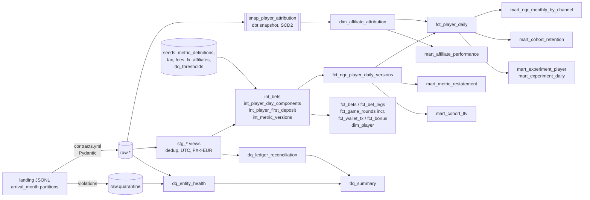
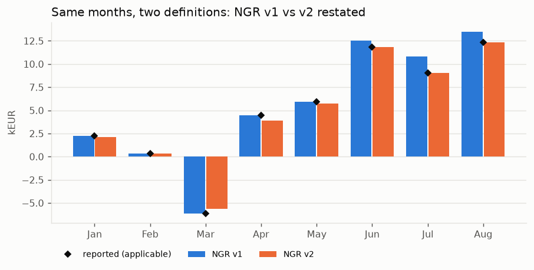
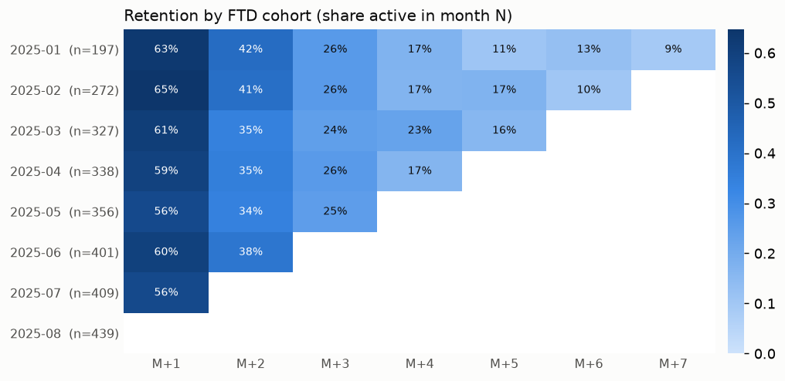
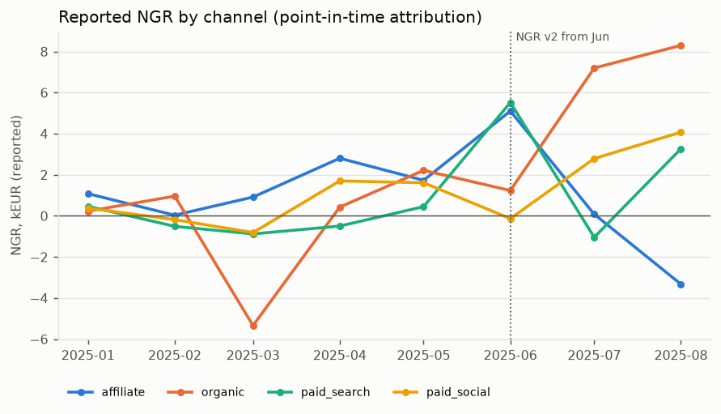

# igaming-metrics-warehouse

Доверенный pipeline метрик для онлайн-оператора (sportsbook + casino): data contracts на входе, карантин, dbt-слои staging → intermediate → marts, SCD2-атрибуция аффилиатов, версионированные определения GGR/NGR, сверка с кошельком (ledger reconciliation), DQ-сводка и A/B-разбор CRM-эксперимента с CUPED, sequential monitoring и harm-guardrail.

> **Все данные в репозитории синтетические (SYNTHETIC DEMO DATA).** Их генерирует детерминированный симулятор `imw.generator` (seed 42). Ни одна цифра не относится к реальному оператору, игрокам или аффилиатам.

Здесь важен не dashboard, а то, что каждой цифре можно доверять: известно, откуда она взялась, по какому определению посчитана и какие проверки прошла.

**Стек:** Python 3.12 (uv, Pydantic v2, pandas, NumPy, SciPy, matplotlib) · dbt-core 1.12 + dbt-duckdb · DuckDB как локальный warehouse · pytest · ruff · GitHub Actions.

## Быстрый старт

Нужны Python 3.12 и [uv](https://docs.astral.sh/uv/). Docker и облачный warehouse не нужны.

```bash
uv sync
uv run imw all          # generate -> load (9 батчей + snapshot) -> dbt build -> experiment -> report
# ~4 минуты на ноутбуке; результат: warehouse/imw.duckdb, reports/report.html
```

По шагам:

```bash
uv run imw generate --seed 42 --players 4000   # landing zone: data/landing/<entity>/arrival_month=YYYY-MM.jsonl
uv run imw load                                # contracts + quarantine, dbt snapshot после каждого месячного батча
uv run dbt build --project-dir dbt --profiles-dir dbt   # seeds, snapshot, 36 моделей, 120 тестов
uv run imw experiment                          # reports/experiment_readout.json
uv run imw report --img-dir docs/img           # reports/report.html (+ PNG)
uv run pytest && uv run ruff check .
```

`dbt` запускается из корня репозитория: путь к DuckDB задаётся `IMW_DUCKDB_PATH` (по умолчанию `warehouse/imw.duckdb`).

## Что генерируется

Симулятор проходит по каждому игроку день за днём (регистрация → KYC → FTD → сессии → отток) и пишет 11 типов событий в landing zone, разбитую по **месяцу прихода** (не события): players, kyc_events, affiliate_touchpoints, attribution_events, wallet_transactions, bets (смены состояния: open → settled), bet_legs, game_rounds, bonus_events (grant / wager / convert / forfeit), rg_events (deposit limit, self-exclusion), experiment_assignments.

Дефекты внесены намеренно, чтобы pipeline было что ловить:

| Дефект | Как внесён | Где ловится |
|---|---|---|
| Дубли (at-least-once delivery) | ~0.4% событий доставлены дважды с тем же `event_id` | raw хранит всё; staging оставляет первое прибытие; `duplicate_rate` |
| Опоздания | ~1.5% событий приходят через 1 ч – 10 дней; legacy-провайдер шлёт батч на следующий день | инкрементальная модель по `_ingested_at`, `late_arrival_rate` |
| Часовые пояса | legacy-провайдер шлёт локальное время Europe/Malta без offset; 15% wallet-транзакций с offset `+02:00/+03:00` | контракт `timezone_by_source`, DST-gap/fold, флаг `_tz_adjusted` |
| Нарушения контракта | ~0.15%: отрицательные суммы, epoch-millis, неизвестная валюта, enum в верхнем регистре, пропущенные поля, битый JSON | `raw.quarantine` с текстом ошибок |
| Тяжёлые хвосты | выигрыш казино: Pareto(α=1.9), cap 2000x; RTP ≈ 0.956 | winsorization sensitivity, CUPED на NGR |
| Разрывы леджера | потерянные win-callback (0.05%) и двойные зачисления (0.02%) | `dq_ledger_reconciliation` |
| Смена атрибуции | late postback, спор между аффилиатами, fraud reversal | dbt snapshot (SCD2), point-in-time join |

## Lineage моделей



Схемы DuckDB: `raw`, `snapshots`, `reference` (seeds), `staging`, `intermediate`, `marts`, `dq`.

## Определения метрик

Все денежные метрики в EUR (курс месяца события из seed `fx_rates`), день = UTC-день. Сверка с кошельком идёт в валюте игрока, без FX-шума.

| Метрика | Определение | Где |
|---|---|---|
| GGR sportsbook | ставки − выплаты по ставкам, **рассчитанным** в этот день; void исключены; курс месяца расчёта | `int_bets`, `int_player_day_components` |
| GGR casino | ставки − выигрыши раундов дня | `int_player_day_components` |
| NGR v1 (2025-01-01 … 2025-05-31) | GGR − bonus cost (converted) − payment fees − gaming tax | seed `metric_definitions` |
| NGR v2 (с 2025-06-01) | v1 − provider fees − chargebacks | seed `metric_definitions` |
| Bonus cost | сумма бонусов, конвертированных в cash (`bonus_cost_basis=converted`; `granted` поддерживается реестром) | `fct_ngr_player_daily_versions` |
| Payment fees | `pct_fee × amount + fixed_fee` по методу и типу операции, включая fee за chargeback | seed `payment_fee_schedule` |
| Gaming tax | ставка по продукту и дате × GGR продукта (casino: 15% → 18% с 2025-04-01) | seed `gaming_tax_rates` |
| Provider fees | rev-share провайдера × casino GGR | seed `provider_fee_schedule` |
| FTD | первый депозит игрока | `int_player_first_deposit` |
| QFTD | FTD, у которого депозиты за 30 дней ≥ порога сделки аффилиата и есть ≥ 1 ставка/раунд | `mart_affiliate_performance` |
| Retention M+N | доля FTD-когорты, сделавшая ставку или раунд в месяце N после FTD | `mart_cohort_retention` |
| LTV to date | накопленный NGR на FTD-игрока; **для всех когорт одна версия** (v2) | `mart_cohort_ltv` |
| Active player | ≥ 1 ставка или раунд за день | `fct_player_daily.is_active` |

## Ключевые решения

- **Контракт как код.** `contracts/contracts.yml` — единственный источник схемы; из него строятся Pydantic-модели (strict: `"12.5"` не число, `1` не bool) и DDL raw-таблиц. Лишние поля отбрасываются (аддитивная эволюция), всё остальное — в `raw.quarantine` с исходной строкой и списком ошибок. Batch идемпотентен через `raw._ingestion_log`.
- **Raw append-only, дедупликация в staging.** Дубли не удаляются на входе, иначе `duplicate_rate` нечем было бы мерить. В staging остаётся **первое** прибытие `event_id`, поэтому инкрементальная модель никогда не видит «новую» копию старого события.
- **Инкремент по времени прихода.** `fct_game_rounds` фильтруется по `_ingested_at`, а не по `round_ts`: раунд за март, пришедший в апреле, не теряется.
- **Время.** Всё хранится как naive UTC. Локальное время legacy-провайдера переводится по IANA-зоне; несуществующее время (переход на летнее) сдвигается вперёд на час, двусмысленное (переход на зимнее) берётся как первое вхождение (`fold=0`). Проверка: 0 расхождений между `round_ts` и временем парной wallet-транзакции на 36 859 раундах legacy-провайдера.
- **SCD2 через dbt snapshot по батчам.** `imw load` запускает `dbt snapshot` после каждого месячного батча, поэтому история атрибуции отражает то, что было известно на момент загрузки, а `valid_from` = время решения (`timestamp`-стратегия). NGR по каналам использует атрибуцию на конец дня активности, а аффилиатская сделка — на момент FTD.
- **Late-arriving dimension.** Если регистрация игрока попала в карантин, а его транзакции прошли, `dim_player` создаёт inferred member (`is_inferred = true`), и relationships-тесты остаются честными.
- **Метрики версионируются, а не переписываются.** Компоненты NGR считаются один раз на уровне player-day, а определения хранятся в seed с `valid_from/valid_to` и флагами компонентов. `fct_ngr_player_daily_versions` считает NGR по **каждой** версии для **каждого** дня; `is_applicable` помечает ту, что действовала. Отсюда reported (как было отчитано) и restated (как было бы по новой политике) — воспроизводимо из тех же seed и данных.
- **Reconciliation объясняет разрывы.** Каждый разрыв помечается `has_quarantined_record`. Разрыв рядом с записью в карантине объяснён (запись есть, но нарушила контракт); без неё деньги двигались без видимой причины (lost callback, double credit). У этих двух классов разные пороги.
- **Пороги DQ — данные, а не код.** Seed `dq_thresholds` (warn/fail, с переопределением по сущности). `dq_summary` выставляет pass/warn/fail, singular-тест роняет build на любом `fail`.

## Результаты (seed 42, 4 000 игроков, 2025-01 … 2025-08)

Полный отчёт: [`docs/report.html`](docs/report.html). Все цифры синтетические.

| | |
|---|---|
| Строк в landing (события + дубли) / принято в raw / в карантине | 834 070 / 832 840 / 1 230 |
| Активных игроков | 2 737 |
| Депозиты / GGR / NGR (reported), EUR | 1 582 024 / 102 043 / 40 038 |
| dbt build | 164 узла: PASS 162, WARN 2, ERROR 0 |
| DQ-сводка | 35 pass, 5 warn, 0 fail |

**Смена определения NGR.** За январь–май reported NGR (v1) = 6 824 EUR, пересчёт тех же месяцев по v2 = 6 463 EUR (−5.3%). Отчитанные цифры не меняются: v2 применяется с июня, а restatement лежит рядом, в `mart_metric_restatement`.







Минус в марте даёт один раунд: выигрыш 8 987 при ставке 14 (642x, ≈ −9 тыс. EUR NGR). Хвост так и задуман: на синтетических объёмах один крупный выигрыш перекрывает месячный hold канала.

**Сверка с кошельком:** 78 956 player-day-компонент, 1 081 разрыв (1.37%), из них 368 (0.47%) не объясняются карантином. Оба значения в статусе `warn`: разрывы внесены в генератор намеренно, построчный список выдаёт warn-тест `assert_ledger_breaks_listed`.

**Аффилиаты** (атрибуция на момент FTD, CPA подобраны под масштаб синтетической экономики):

| Аффилиат | Сделка | FTD | QFTD | Переатрибутировано позже | NGR, EUR | Стоимость, EUR | Contribution, EUR |
|---|---|---|---|---|---|---|---|
| AFF01 | hybrid | 118 | 98 | 0 | −1 817 | 1 850 | −3 667 |
| AFF02 | cpa | 109 | 94 | 4 | 445 | 2 350 | −1 905 |
| AFF03 | revshare | 94 | 82 | 0 | 4 889 | 1 795 | 3 094 |
| AFF04 | cpa | 128 | 109 | 3 | 977 | 2 180 | −1 203 |
| AFF05 | hybrid | 79 | 62 | 3 | −3 003 | 657 | −3 661 |
| AFF06 | cpa | 334 | 302 | 36 | 625 | 4 530 | −3 905 |
| AFF07 | revshare | 127 | 108 | 1 | 1 939 | 992 | 947 |
| AFF08 | cpa | 110 | 100 | 10 | 63 | 1 200 | −1 137 |

У AFF06 (бонусный портал) втрое больше FTD, чем у остальных, но contribution самый отрицательный: игроки забирают бонусы и уходят, а у 36 FTD атрибуция позже изменилась (в основном fraud reversal). Это типичный случай, когда большой объём FTD даёт отрицательную маржу. Минус у AFF01 и AFF05 другой природы: пара крупных выигрышей на небольшой базе игроков.

### CRM-эксперимент (reactivation bonus, 28 дней, 1 480 игроков)

| Метрика | Raw эффект | CUPED эффект | p (CUPED) | Снижение дисперсии |
|---|---|---|---|---|
| Депозиты на игрока, EUR | +74.3 | +50.1 [23.8; 76.4] | 0.0002 | 59% (ρ pre/post = 0.77) |
| NGR на игрока, EUR | +6.2 | +6.1 | 0.21 | ≈0% (ρ pre/post ≈ 0.00) |

- CUPED хорошо работает на депозитах, но ничего не даёт на NGR: тяжёлые хвосты выигрышей обнуляют корреляцию pre/post.
- Winsorization как sensitivity analysis: эффект на NGR зависит от cap (+6.2 без cap, +3.9 при p1/p99, ≈0 при p5/p95, где обрезано 75% |NGR|). Вывод «NGR вырос» по этим данным сделать нельзя, и таблица это показывает, а не прячет.
- Sequential (mSPRT, τ = 0.1·sd pre-периода): always-valid p по депозитам опускается ниже 0.05 на 4-й день. Наивный fixed-horizon p ниже 0.05 уже в первый день; тест `test_msprt_controls_type_one_error_under_peeking` показывает, что такое подглядывание раздувает ошибку I рода выше 15%, а mSPRT держит её ≤ 6%.
- Guardrail «доля игроков, упёршихся в deposit limit»: 3.2% против 2.6%, разница +0.64 п.п., верхняя граница одностороннего 95% CI +2.1 п.п. при марже 1 п.п. Статус `inconclusive`: вред не исключён, поэтому раскатывать только по росту депозитов нельзя.

## Тесты

- **dbt (120):** `unique`, `not_null`, `relationships`, `accepted_values` на staging и marts; кастомные generic-тесты `duplicate_rate_below`, `late_arrival_rate_below`, `event_freshness_within` (относительно `data_as_of`, а не wall clock), `no_overlapping_intervals` (SCD2), `unique_combination`, `expression_is_true`; singular-тесты: порог ledger break rate, отсутствие `fail` в DQ-сводке, непрерывность версий метрик, ровно одна применимая версия NGR на player-day, согласованность GGR между гранулярностями, совпадение restatement с reported, отсутствие ставок после self-exclusion, вывод средств только после KYC.
- **pytest (37):** контракты (strict-типы, epoch, offset, DST gap/fold, legacy-источник), детерминизм генератора, RTP, баланс рандомизации, идемпотентность ingestion и карантин, CUPED (снижение дисперсии ≈ ρ² при ρ = 0.3/0.6/0.9, несмещённость), winsorization, mSPRT (ошибка I рода при подглядывании, мощность), SRM, guardrail, интеграционные проверки собранного warehouse.
- **CI:** `.github/workflows/ci.yml`: uv sync → ruff → unit-тесты → generate → load → `dbt build` → интеграционные тесты → отчёт как artifact.

## Ограничения

- Данные синтетические: поведение игроков, маржи, RTP, CPA и налоговые ставки правдоподобны по форме, но не откалиброваны по рынку. Абсолютные суммы малы (4 000 игроков).
- Provider fees и gaming tax считаются на уровне player-day и могут быть отрицательными. В реальности налог и rev-share считаются по периоду с правилами переноса. Rev-share аффилиата берётся с положительного NGR без negative carry-over.
- Snapshot делается раз в месяц прихода: две смены атрибуции одного игрока внутри батча схлопываются в последнюю. Для точной истории нужен snapshot чаще или SCD2 из журнала событий.
- Разрыв, «объяснённый карантином», сопоставляется по игроку и дате ±1 день, а не по ключу транзакции: у части битых строк ключ нечитаем.
- mSPRT применяется к кумулятивным per-player метрикам и предполагает приблизительно гауссовскую динамику оценки. Для метрик с тяжёлым хвостом это приближение.
- `data_as_of` зафиксирован (2025-09-01): freshness проверяется относительно времени событий, а не текущей даты.
- ClickHouse/Snowflake не используются. Модели написаны на близком к ANSI SQL; DuckDB-специфичны `QUALIFY`, `arg_max`, `json_extract_string`.

## Как это соотносится с вакансией

| Требование вакансий (BI / data analyst iGaming, analytics / betting data engineer) | Где в репозитории |
|---|---|
| SQL, dbt, слоистая модель данных | `dbt/models`: staging → intermediate → marts, 36 моделей |
| GGR / NGR, FTD / QFTD, retention, LTV | `fct_ngr_player_daily_versions`, `mart_cohort_*`, `mart_affiliate_performance` |
| Metric governance, воспроизводимость | seed `metric_definitions`, `mart_metric_restatement` |
| Data quality, data contracts | `contracts/contracts.yml`, `raw.quarantine`, `dq_*`, 120 dbt-тестов |
| Late-arriving data, дубли, часовые пояса | staging dedup, инкремент по `_ingested_at`, `timezone_by_source` |
| Affiliate attribution, SCD | `snap_player_attribution`, `dim_affiliate_attribution` |
| A/B-тесты: CUPED, sequential, guardrails | `src/imw/experiment.py`, `tests/test_experiment.py` |
| Python для данных | генератор, ingestion, анализ экспериментов, отчёт |
| Snowflake / BigQuery / ClickHouse, Spark / Kafka | не используются: DuckDB как локальная замена; landing по arrival-партициям и инкремент по времени прихода переносятся на Kafka → ClickHouse без смены логики |

## Структура

```
contracts/contracts.yml      data contracts (источник схемы raw)
src/imw/generator.py         симулятор оператора (SYNTHETIC DEMO DATA)
src/imw/contracts.py         YAML -> Pydantic, нормализация времени
src/imw/ingest.py            landing -> raw + quarantine, идемпотентные батчи
src/imw/pipeline.py          батчи + dbt snapshot, запуск dbt
src/imw/experiment.py        SRM, CUPED, winsorization, mSPRT, guardrail
src/imw/report.py            статический HTML-отчёт
dbt/                         dbt-проект (seeds, snapshots, models, tests, macros)
docs/                        пример отчёта и графики
```

Лицензия: MIT.
